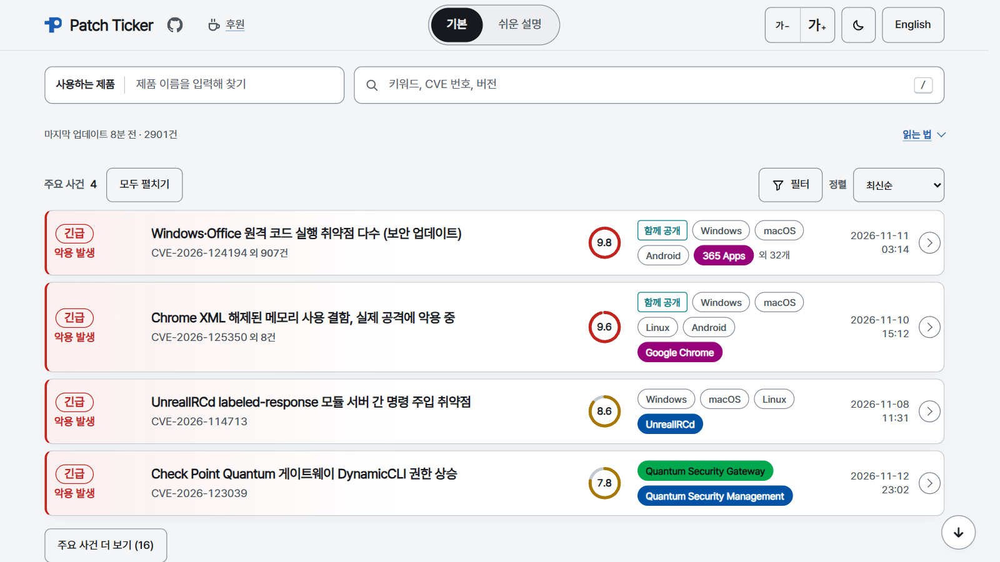

<p align="center">
  <a href="https://patchticker.com/"></a>
</p>

<h1 align="center">Patch Ticker</h1>

<p align="center"><a href="README.md"><b>English</b></a> | <b>한국어</b></p>

<p align="center">
  <b>새로 터진 보안 취약점을, 내가 쓰는 제품 기준으로 빠르게.</b><br>
  로그인 없이 누구나 보는 실시간 보안 취약점 현황판 (<a href="https://patchticker.com/">한국어</a> · <a href="https://patchticker.com/en/">English</a>).
</p>

<p align="center">
  <a href="https://patchticker.com/"></a>
  
  <a href="LICENSE"></a>
</p>

<p align="center">
  <a href="https://patchticker.com/">
    <picture>
      <source media="(prefers-color-scheme: dark)" srcset="docs/assets/screenshot-ko-dark.png">
      
    </picture>
  </a>
</p>

## 왜 만들었나요

새 취약점 소식이 뜨면 궁금한 건 두 가지입니다. **내가 쓰는 것과 상관이 있나**, 있다면 **지금 뭘 해야 하나**.
Patch Ticker는 이 두 질문에 몇 초 안에 답합니다. 보안을 잘 모르는 분도 쓸 수 있게 만들었습니다.

## 할 수 있는 일

- **실시간**: 10분마다 새 소식을 모으고, 열어 둔 화면은 자동으로 갱신됩니다.
- **내 제품만 보기**: 쓰는 제품을 고르면 그 사건만 남습니다. 고른 내용은 내 브라우저에만 저장되며 주소로 공유할 수 있습니다.
- **평소 부르는 이름으로 검색**: 아웃룩, 파폭, vscode 같은 별칭으로도 찾습니다.
- **한국어·영어 요약**: 무엇이 문제인지, 누가 영향을 받는지, 어떻게 막는지 정리합니다.
- **쉬운 설명**: 보안 용어 없이 위험도와 "지금 할 일" 하나만 보여 줍니다.
- **주요 사건**: 점수, 제품 사용 규모, 실제 공격 여부, 최신순을 종합해 이번 주 주요 사건을 맨 위에 올립니다.
- **CVE 번호가 나오기 전에도**: 분석 글과 메일링 리스트 소식을 바로 올리고, 번호가 붙으면 합칩니다.
- **묶음**: 한 회사가 같은 날 낸 공지, 한 번의 업데이트로 고쳐진 취약점은 한 줄로 묶습니다.
- **원문 연결**: 모든 내용에 원문 링크가 있고, 명령어는 원문에 적힌 그대로만 보여 줍니다.

## 직접 주소 · RSS · API

- **CVE 직접 주소**: 보관 기간(90일, 주요 사건은 1년) 안의 요약된 CVE는 `https://patchticker.com/i/<CVE번호>`로 바로 열 수 있습니다. 다른 사건에 묶인 CVE도 해당 사건 페이지로 자동 이동(`301`)합니다.
- **목록 둘러보기**: [날짜별 목록](https://patchticker.com/d/) · [제품별 목록](https://patchticker.com/p/)
- **RSS 구독**:
  - 주요 피드(위험 이상, 실제 공격, CVE 미배정 속보): [한국어](https://patchticker.com/feed.xml) · [영어](https://patchticker.com/en/feed.xml)
  - 현황판 전체(참고 수준까지 모든 사건): [한국어](https://patchticker.com/feed/all.xml) · [영어](https://patchticker.com/en/feed/all.xml)
  - 내 제품만 구독: `/feed.xml?products=openssh,크롬` (이름 30개까지, 현황판의 RSS 버튼이 고른 제품으로 주소를 만들어 줍니다)
- **AI 에이전트·스크립트용 API**: `GET /api/check`에 제품 이름을 보내면 해당 사건을 JSON으로 돌려줍니다(API 키는 필요 없고, 클라이언트 이름을 담은 `User-Agent`만 보내면 됩니다). 자세한 사양은 [llms.txt](https://patchticker.com/llms.txt)에 있습니다.

```sh
curl -A "my-script/1.0" "https://patchticker.com/api/check?products=openssh,nginx&min=high"
```

## 위험도

위험도는 AI가 아니라 정해진 규칙으로 매깁니다.

| 표시 | 기준 |
| --- | --- |
| **긴급** | 실제 공격 확인(CISA KEV, 또는 공격을 전한 원문) 또는 CVSS 9.0 이상 |
| **위험** | CVSS 7.0 이상 |
| **참고** | 그 밖의 사건 |

"공격 발생"에는 항상 근거가 붙습니다. 공격 코드만 공개된 경우는 "공격 코드 공개됨"으로 따로 알립니다.

## 데이터 출처

| 출처 | 쓰는 곳 |
| --- | --- |
| [CVE 목록 (cvelistV5)](https://github.com/CVEProject/cvelistV5) | 새 CVE, 영향받는 제품과 버전, 공식 공지 |
| [NVD](https://nvd.nist.gov/) | CVSS 점수, 제품 정보 |
| [CISA KEV](https://www.cisa.gov/known-exploited-vulnerabilities-catalog) | 실제로 악용된 취약점 |
| [oss-security](https://www.openwall.com/lists/oss-security/), Hacker News, GitHub | CVE 번호가 나오기 전의 소식과 분석 글 |
| tl;dr sec, Risky Business News | 주목받는 사건 |
| [BleepingComputer](https://www.bleepingcomputer.com/), [SecurityWeek](https://www.securityweek.com/) | 뉴스로 먼저 알려진 공격과 해킹 (CVE 번호가 없는 경우가 많음) |
| [KISA 보호나라](https://www.boho.or.kr/) | 사건의 CVE에 대한 한국어 보안 공지 |
| Debian, Ubuntu, Red Hat, SUSE, Alpine, Arch 보안 트래커 | 리눅스 배포판별 수정 여부 |

요약은 AI가 위 원문만 바탕으로 작성한 뒤 규칙 검증과 2차 검토를 거칩니다. `/api/check`가 모르는 제품 이름은 AI가 영어 이름을 추측해 다시 찾고, 그렇게 찾은 결과는 `maybe`로 표시합니다.

## 작동 방식

```
수집기 (Docker, 10분마다)  ──쓰기──▶  Cloudflare R2 (공개 JSON)  ◀──읽기──  웹 페이지 (Cloudflare Pages)
   CVE 목록, NVD, KEV,                 월별 사건 파일, status.json            필터와 검색은 브라우저에서
   메일링 리스트, HN, GitHub
```

방문자 요청을 처리하는 별도 백엔드 서버는 없습니다. 페이지, RSS, `/api/check` 모두 같은 공개 파일에서 만들어집니다.
직접 실행하는 법: [docs/development.md](docs/development.md).

## 개인정보

로그인, 쿠키, 광고 추적기가 없습니다. 방문 수만 익명으로 셉니다. 고른 제품과 필터는 내 브라우저 밖으로 나가지 않습니다.
`/api/check`는 요청을 저장하지 않고, 모르는 제품 이름만 AI에 보냅니다.

## 자주 묻는 질문

**Q. 기존 CVE 데이터베이스와 뭐가 다른가요?**

관련 CVE, CISA KEV, KISA 공지, 리눅스 6개 배포판 패치 여부를 사건 한 줄로 묶어 쉬운 대처법과 `/api/check` API까지 제공합니다.

**Q. AI 요약이 버전이나 명령어를 지어낼 수 있나요?**

위험도는 규칙이 정합니다. 원문에 없는 숫자나 버전이 들어가면 걸러 내 다시 쓰게 하고, 명령어는 요약 입력 자료에 그대로 적힌 것만 보여 줍니다.

**Q. 왜 현황판 90일, 주요 사건 페이지 1년인가요?**

과거 전체 DB가 아니라 지금 패치할 것을 빠르게 추리는 실시간 현황판이기 때문입니다.

**Q. CI, 봇, AI 에이전트에서 써도 되나요?**

네, API 키 없이 `/api/check?products=...`나 `/feed.xml?products=...`를 호출하면 됩니다(10분에 1회 이하, `User-Agent` 지정).

## 제보와 개선 제안

- **틀린 내용 알리기**: 사건을 펼쳐 **틀린 내용 알리기**를 누르면 해당 사건 정보가 채워진 이슈가 바로 열립니다.
- **개선 제안·기능 요청**: 불편한 점이나 추가했으면 하는 기능, 수집처 제안도 [이슈 목록](https://github.com/dwamaker/PatchTicker/issues)에 편하게 남겨 주세요.
- 반영된 내용은 [릴리스](https://github.com/dwamaker/PatchTicker/releases)에 기록합니다.

<p align="center">
  <em>광고 없이 무료로 운영합니다. 도움이 되셨다면 커피 한 잔으로 응원해 주세요.</em><br>
  <a href="https://buymeacoffee.com/dwamaker"></a>
</p>

## 고지와 라이선스

- 이 현황판은 참고용입니다. 조치하기 전에 각 사건의 원문 공지를 확인하세요. 사건은 현황판에 90일, 주요 사건 페이지에는 1년 동안 남습니다(90일 이후에는 갱신되지 않습니다).
- This product uses data from the NVD API but is not endorsed or certified by the NVD.
- CVE® records: Copyright © 1999–2026, The MITRE Corporation. CVE is a registered trademark of The MITRE Corporation.
  Used under the [CVE Terms of Use](https://www.cve.org/Legal/TermsOfUse).
- 코드는 [MIT 라이선스](LICENSE)를 따릅니다. CVE와 NVD 데이터는 각자의 이용 조건을 따르고, 수집한 데이터와 요약문은
  이 라이선스에 포함되지 않습니다.
