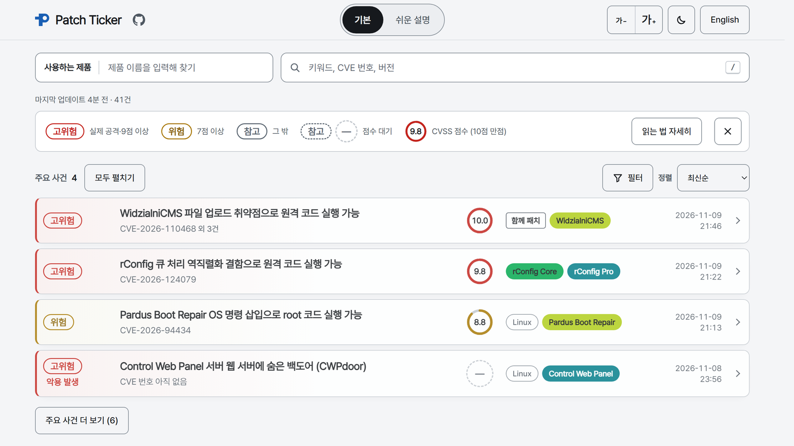

<p align="center">
  <a href="https://patchticker.dwamaker.com"></a>
</p>

<h1 align="center">Patch Ticker</h1>

<p align="center">
  <b>새로 터진 보안 취약점을, 내가 쓰는 제품 기준으로 빠르게.</b><br>
  로그인 없이 누구나 보는 한국어 보안 취약점 게시판.
</p>

<p align="center">
  <a href="https://patchticker.dwamaker.com"></a>
  
  <a href="LICENSE"></a>
  <a href="README.md"></a>
</p>

<p align="center">
  <a href="https://patchticker.dwamaker.com">
    <picture>
      <source media="(prefers-color-scheme: dark)" srcset="docs/assets/screenshot-ko-dark.png">
      
    </picture>
  </a>
</p>

## 왜 만들었나요

보안 뉴스에 새 취약점이 뜨면 궁금한 건 두 가지입니다. **내가 쓰는 것과 상관이 있나**, 있다면 **지금 뭘 해야 하나**.
Patch Ticker는 이 두 질문에 몇 초 안에 답합니다. 보안 담당자뿐 아니라 집에서 서버를 돌리는 분, 작은 회사의 관리자,
보안을 잘 모르는 분도 쓸 수 있게 만들었습니다.

## 할 수 있는 일

- **실시간 최신순**: 10분마다 모으고, 열어 둔 페이지는 새로고침 없이 바뀝니다.
- **내 제품만 보기**: 쓰는 제품을 고르면 그 제품의 사건만 남습니다. 고른 제품은 내 브라우저에만 저장됩니다.
- **한국어 요약**: 무엇이 문제인지, 누가 영향을 받는지, 언제 위험한지, 어떻게 막는지 정리합니다.
- **쉬운 설명**: 보안 용어 없이 위험도와 "지금 할 일" 하나만 보여 줍니다.
- **CVE 번호가 나오기 전에도**: 분석 글과 메일링 리스트 소식을 바로 올리고, 번호가 붙으면 합칩니다.
- **묶음**: 한 회사가 같은 날 낸 공지, 한 번의 업데이트로 함께 고쳐진 취약점은 한 줄로 묶습니다.
- **모든 내용은 원문으로**: 업데이트 명령어는 원문에 그대로 적혀 있을 때만 보여 줍니다.
- **공유하기 쉽게**: 사건마다 링크가 있고, 필터도 주소에 담깁니다. 밝은·어두운 테마, 휴대폰 화면을 지원합니다.

## 위험도

위험도는 AI가 아니라 정해진 규칙이 정합니다.

| 표시 | 기준 |
| --- | --- |
| **고위험** | 실제 공격 확인(CISA KEV, 또는 공격을 전한 원문) 또는 CVSS 9.0 이상 |
| **위험** | CVSS 7.0 이상 |
| **참고** | 그 밖의 사건 |

"악용 발생"에는 항상 근거가 함께 표시됩니다. 공격 코드가 공개되기만 한 경우는 "공격 코드 공개됨"으로 따로 알립니다.

## 데이터 출처

| 출처 | 쓰는 곳 |
| --- | --- |
| [CVE 목록 (cvelistV5)](https://github.com/CVEProject/cvelistV5) | 새 CVE, 영향받는 제품과 버전, 공식 공지 |
| [NVD](https://nvd.nist.gov/) | CVSS 점수, 제품 정보 |
| [CISA KEV](https://www.cisa.gov/known-exploited-vulnerabilities-catalog) | 실제로 악용된 취약점 |
| [oss-security](https://www.openwall.com/lists/oss-security/), Hacker News, GitHub | CVE 번호가 나오기 전의 소식과 분석 글 |
| tl;dr sec, Risky Business News | 주목받는 사건 |

요약은 Anthropic의 Claude가 위 원문만 읽고 씁니다. 원문에 없는 숫자나 버전이 들어간 요약은 버리고 다시 씁니다.

## 개인정보

로그인, 쿠키, 방문 분석, 추적기가 없습니다. 고른 제품과 필터는 내 브라우저 밖으로 나가지 않습니다.

## 틀린 내용을 발견하면

사건을 펼쳐 **틀린 내용 알리기**를 누르면, 사건 정보가 채워진 이슈 양식이 이 저장소에 열립니다.
[이슈 목록](https://github.com/dwamaker/PatchTicker/issues)에서 직접 남겨도 됩니다.

## 작동 방식

```
수집기 (Docker, 10분마다)  ──쓰기──▶  Cloudflare R2 (공개 JSON)  ◀──읽기──  웹 페이지 (Cloudflare Pages)
   CVE 목록, NVD, KEV,                 월별 사건 파일, status.json            필터와 검색은 브라우저에서
   메일링 리스트, HN, GitHub
```

방문자의 요청에 답하는 서버가 없습니다. 직접 실행하는 법: [docs/development.md](docs/development.md).

## 고지와 라이선스

- 이 게시판은 참고용입니다. 조치하기 전에 각 사건의 원문 공지를 확인하세요.
- This product uses data from the NVD API but is not endorsed or certified by the NVD.
- CVE® records: Copyright © 1999–2026, The MITRE Corporation. CVE is a registered trademark of The MITRE Corporation.
  Used under the [CVE Terms of Use](https://www.cve.org/Legal/TermsOfUse).
- 코드는 [MIT 라이선스](LICENSE)를 따릅니다. CVE와 NVD 데이터는 각자의 이용 조건을 따르고, 수집한 데이터와 요약문은
  이 라이선스에 포함되지 않습니다.
