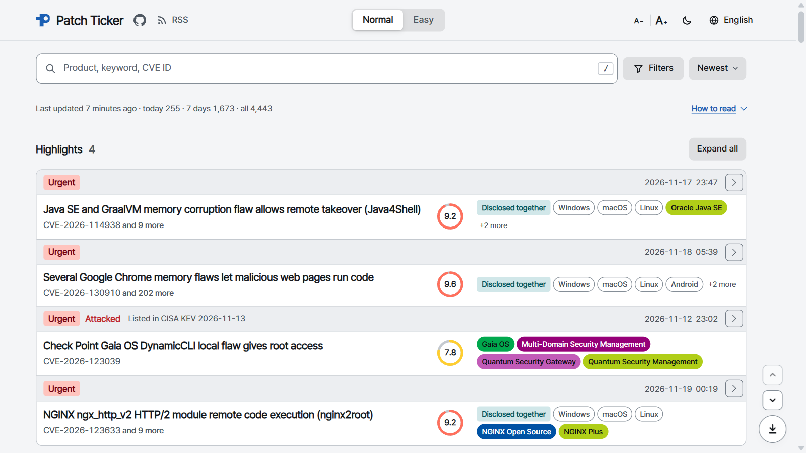

<p align="center">
  <a href="https://patchticker.com/en/"></a>
</p>

<h1 align="center">Patch Ticker</h1>

<p align="center"><b>English</b> | <a href="README.ko.md"><b>한국어</b></a></p>

<p align="center">
  <b>New security vulnerabilities, sorted by the products you run.</b><br>
  A free, no-login live tracker in <a href="https://patchticker.com/en/">English</a> and <a href="https://patchticker.com/">Korean</a>.
</p>

<p align="center">
  <a href="https://patchticker.com/en/"></a>
  
  <a href="LICENSE"></a>
</p>

<p align="center">
  <a href="https://patchticker.com/en/">
    <picture>
      <source media="(prefers-color-scheme: dark)" srcset="docs/assets/screenshot-en-dark.png">
      
    </picture>
  </a>
</p>

## Why

When a vulnerability hits the news, you want two answers: **does it touch anything I run**, and **what do I do now**.
Patch Ticker answers both in seconds, with no security background needed.

## Features

- **Live**: collected every 10 minutes; an open page updates by itself.
- **Your products only**: pick what you run and the list narrows to it. Picks stay in your browser and can be shared by URL.
- **Plain summaries** in English and Korean: what it is, who is affected, how to fix it.
- **Easy view**: no jargon, just the risk and one thing to do now.
- **Highlights**: the week's Incidents ranked by score, reach, active attacks and recency stand on top.
- **Before a CVE exists**: write-ups and mailing-list posts show up at once and merge when the CVE is assigned.
- **Folds**: one vendor's same-day notices, and fixes shipped in one update, fold into one line.
- **Linked to sources**: every claim links to its source; a command is shown only as a source wrote it.

## Direct URLs, RSS and API

- **Direct CVE URLs**: every CVE with a Summary from the last 90 days (major Incidents: 1 year) is reachable at
  `https://patchticker.com/en/i/<CVE-ID>` (or `/i/<CVE-ID>` in Korean). A CVE grouped into another Incident redirects
  (`301`) to that Incident's page.
- **Browse lists**: by [day](https://patchticker.com/en/d/) or by [product](https://patchticker.com/en/p/).
- **RSS**:
  - Main feed (Elevated and up, attacked or no CVE yet): [English](https://patchticker.com/en/feed.xml) · [Korean](https://patchticker.com/feed.xml)
  - Whole Board (every level, light items): [English](https://patchticker.com/en/feed/all.xml) · [Korean](https://patchticker.com/feed/all.xml)
  - Only your products: `/en/feed.xml?products=openssh,nginx` (up to 30 names; the site's RSS button builds it from your picks)
- **JSON API for scripts and AI agents**: `GET /api/check` answers which Incidents touch the products you run, with `detail`
  linking each full record. No API key; send a `User-Agent` naming your client (`Python-urllib`'s bare default gets 403
  from Cloudflare). Full spec: [llms.txt](https://patchticker.com/llms.txt).

```sh
curl -A "my-script/1.0" "https://patchticker.com/api/check?products=openssh,nginx&min=high"
```

## Risk levels

Rules set the level, never the AI.

| Sign | Rule |
| --- | --- |
| **Urgent** | Attacked (CISA KEV, or a source reporting attacks) or CVSS 9.0+ |
| **Elevated** | CVSS 7.0+ |
| **Notice** | Everything else |

"Attacked" always shows its evidence. Published exploit code alone is flagged as "Exploit code is public".

## Data sources

| Source | Used for |
| --- | --- |
| [CVE List (cvelistV5)](https://github.com/CVEProject/cvelistV5) | New CVEs, affected products and versions, advisories |
| [NVD](https://nvd.nist.gov/) | CVSS scores, product data |
| [CISA KEV](https://www.cisa.gov/known-exploited-vulnerabilities-catalog) | Exploited in the wild |
| [oss-security](https://www.openwall.com/lists/oss-security/), Hacker News, GitHub | News and write-ups before a CVE |
| tl;dr sec, Risky Business News | Incidents getting attention |
| [BleepingComputer](https://www.bleepingcomputer.com/), [SecurityWeek](https://www.securityweek.com/) | Attacks and compromises reported as news, often with no CVE |
| [KISA 보호나라](https://www.boho.or.kr/) | Korean security notices for an Incident's CVEs |
| Debian, Ubuntu, Red Hat, SUSE, Alpine and Arch security trackers | Whether each Linux distribution has the fix |

Summaries are written by AI strictly from these sources, checked by rules, and reviewed once more. When `/api/check`
does not know a product name, AI guesses its English name for a second lookup, and any match found that way is marked
`maybe`.

## How it works

```
Collector (Docker, every 10 min)  ──writes──▶  Cloudflare R2 (public JSON)  ◀──reads──  Web page (Cloudflare Pages)
  CVE List, NVD, KEV,                          monthly Incident files,                  filters and search run
  mailing lists, HN, GitHub                    status.json                              in the browser
```

No origin server answers visitors. The page, feeds and `/api/check` are all served from the same public files.
Running it yourself: [docs/development.md](docs/development.md).

## Privacy

No login, no cookies, no ad trackers. Visits are only counted anonymously. Picks and filters never leave your
browser. `/api/check` stores nothing about a request; only a product name it does not know is sent to AI.

## FAQ

**Q. How is this different from a CVE database?**

It merges related CVEs, CISA KEV, KISA notices, 6 Linux distribution trackers and advisories into one row per event, with plain-language mitigation and `/api/check`.

**Q. Can AI summaries make up versions or commands?**

Rules set risk levels; a Summary naming a number or version missing from its sources is sent back and rewritten, and a command is shown only when it appears verbatim in the input sources.

**Q. Why 90 days on the Board and 1 year on major pages?**

It is a live triage board for what to patch now, not a historical archive since 1999.

**Q. Can I use it from CI, a bot or an AI agent?**

Yes — call `/api/check?products=...` or `/en/feed.xml?products=...` with no API key (at most once every 10 minutes, with a named `User-Agent`).

## Feedback and issues

- **Report a mistake**: open any Incident and press **Report a mistake** to pre-fill an issue with its details.
- **Suggestions and feature ideas**: improvements, new sources or UX feedback are welcome in [Issues](https://github.com/dwamaker/PatchTicker/issues).
- Shipped fixes and changes are listed under [Releases](https://github.com/dwamaker/PatchTicker/releases).

<p align="center">
  <em>Free, no ads. Find it useful? A coffee keeps it running.</em><br>
  <a href="https://buymeacoffee.com/dwamaker"></a>
</p>

## Notices and license

- For reference only: check each Incident's source advisory before you act. Incidents stay on the Board for 90 days;
  major Incident pages are kept for 1 year (no longer updated after 90 days).
- This product uses data from the NVD API but is not endorsed or certified by the NVD.
- CVE® records: Copyright © 1999–2026, The MITRE Corporation. CVE is a registered trademark of The MITRE Corporation.
  Used under the [CVE Terms of Use](https://www.cve.org/Legal/TermsOfUse).
- Code: [MIT License](LICENSE). CVE and NVD data keep their own terms; the collected data and summaries are not
  covered by this license.
