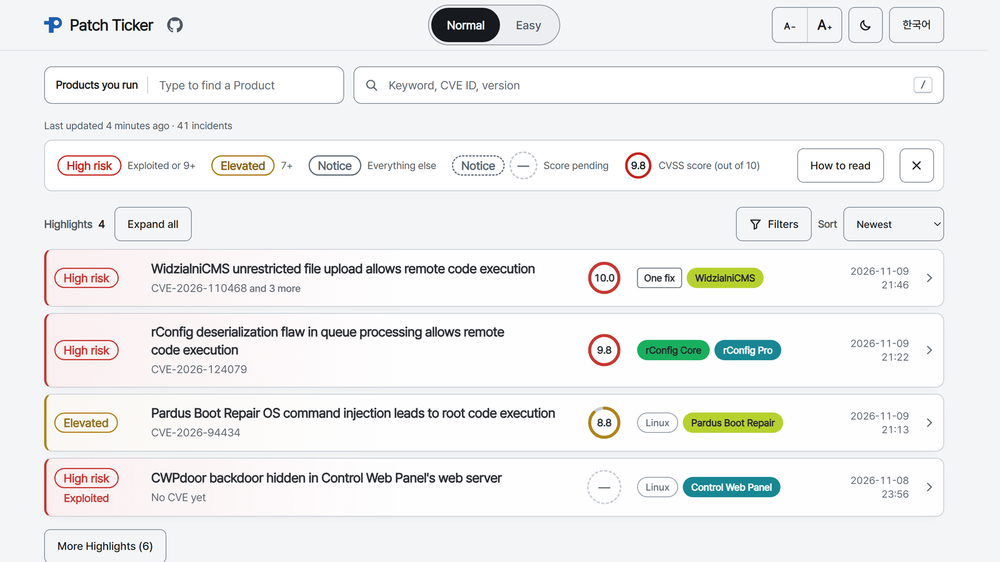

<p align="center">
  <a href="https://patchticker.com"></a>
</p>

<h1 align="center">Patch Ticker</h1>

<p align="center">
  <b>New security vulnerabilities, sorted by the products you run.</b><br>
  A free, no-login board, Korean first with English alongside.
</p>

<p align="center">
  <a href="https://patchticker.com"></a>
  
  <a href="LICENSE"></a>
  <a href="README.ko.md"></a>
</p>

<p align="center">
  <a href="https://patchticker.com">
    <picture>
      <source media="(prefers-color-scheme: dark)" srcset="docs/assets/screenshot-en-dark.png">
      
    </picture>
  </a>
</p>

## Why

When a vulnerability hits the news, you want two answers: **does it touch anything I run**, and **what do I do now**.
Patch Ticker answers both in seconds, for security staff and just as much for home-lab owners, small-company admins and
readers with no security background.

## Features

- **Live, newest first**: collected every 10 minutes; an open page updates without a reload.
- **Your products only**: pick what you run and the board narrows to it. Picks stay in your browser.
- **Plain summaries** in Korean and English: what it is, who is affected, when it is dangerous, how to fix it.
- **Easy view**: no jargon, just the risk and one thing to do now.
- **Before a CVE exists**: write-ups and mailing-list posts show up at once and merge when the CVE is assigned.
- **Folds**: one vendor's same-day notices, and fixes shipped in one update, fold into one line.
- **Every claim links to its source**: commands are shown only when a source states them word for word.
- **Shareable**: a link per Incident; filters live in the address. Light and dark themes, phone ready.

## Risk levels

Rules set the level, never the AI.

| Sign | Rule |
| --- | --- |
| **High risk** | Exploited (CISA KEV, or a source reporting attacks) or CVSS 9.0+ |
| **Elevated** | CVSS 7.0+ |
| **Notice** | Everything else |

"Exploited" always shows its evidence. Published exploit code alone is flagged as "Exploit code is public".

## Data sources

| Source | Used for |
| --- | --- |
| [CVE List (cvelistV5)](https://github.com/CVEProject/cvelistV5) | New CVEs, affected products and versions, advisories |
| [NVD](https://nvd.nist.gov/) | CVSS scores, product data |
| [CISA KEV](https://www.cisa.gov/known-exploited-vulnerabilities-catalog) | Exploited in the wild |
| [oss-security](https://www.openwall.com/lists/oss-security/), Hacker News, GitHub | News and write-ups before a CVE |
| tl;dr sec, Risky Business News | Incidents getting attention |

Summaries are written by Anthropic's Claude from these sources only; one with a number or version not in its sources
is thrown away and written again.

## Privacy

No login, no cookies, no ad trackers. Visits are counted anonymously by Cloudflare Web Analytics (no cookies, no
personal data). Picks and filters never leave your browser.

## Found a mistake?

Open the Incident and press **Report a mistake**: a new issue opens here with the Incident filled in. Or
[open an issue](https://github.com/dwamaker/PatchTicker/issues) yourself.

## How it works

```
Collector (Docker, every 10 min)  ──writes──▶  Cloudflare R2 (public JSON)  ◀──reads──  Web page (Cloudflare Pages)
  CVE List, NVD, KEV,                          monthly Incident files,                  filters and search run
  mailing lists, HN, GitHub                    status.json                              in the browser
```

No server answers visitors. Running it yourself: [docs/development.md](docs/development.md).

## Notices and license

- For reference only: check each Incident's source advisory before you act.
- This product uses data from the NVD API but is not endorsed or certified by the NVD.
- CVE® records: Copyright © 1999–2026, The MITRE Corporation. CVE is a registered trademark of The MITRE Corporation.
  Used under the [CVE Terms of Use](https://www.cve.org/Legal/TermsOfUse).
- Code: [MIT License](LICENSE). CVE and NVD data keep their own terms; the collected data and summaries are not
  covered by this license.
